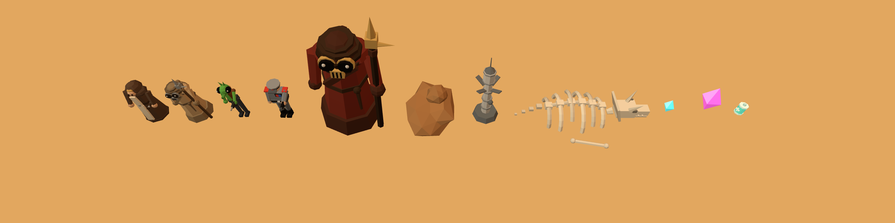

# Twin Suns

A small 3D survival game in the browser. You're alone in a desert at golden hour. Raiders, aliens and officers come at you in waves, and your weapons fire on their own. Collect crystals, level up, pick one upgrade from three, and last ten minutes.



- **Play:** serve this folder over HTTP and open `index.html`, e.g. `python3 -m http.server 8000` then http://localhost:8000. It needs internet access for three.js (loaded from jsDelivr). Opening the file directly (`file://`) won't work.
- **Controls:** drag anywhere to move (touch or mouse), or use WASD / arrow keys. P pauses.
- **No build step.** Plain ES modules and three.js r160.

## Reskinning

Everything that is content lives in [`game/theme.js`](game/theme.js): names, colours, enemy stats, waves, weapons, UI text, and a slot for every model and sound. To use your own 3D model, drop a `.glb` in `assets/` and point its slot at it. To use your own sound, do the same with an `.mp3`, `.ogg` or `.wav`. Step-by-step guide: [`ASSETS.md`](ASSETS.md).

All art in this repo is low-poly geometry generated in code, and all sound is synthesised. There are no third-party assets.

## Tests

```
cd test && npm install && cd ..
node test/smoke.mjs
```

Uses Playwright with Chromium (`npx playwright install chromium` if you don't have it). The smoke test plays through start, level-up, a 150-enemy swarm, the boss, game over, restart, victory, and a touch-drag run at phone size, and fails on any console error. `test/bot.mjs` is a simple kiting bot used for balance runs. The game exposes `window.__game` debug hooks for this; see [`CONTRACT.md`](CONTRACT.md).

## Layout

```
index.html        page, HUD and overlays
game/theme.js     all content and tuning (edit this to reskin)
game/main.js      game loop, enemies, weapons, levelling
game/models.js    placeholder models and .glb loading
game/audio.js     synthesised sound and file overrides
game/world.js     ground, lights, scenery
game/fx.js        particles, bolts, lightning, rings
game/ui.js        HUD, cards, banners
game/input.js     keyboard and touch joystick
assets/           your replacement models and sounds
test/             Playwright harness, smoke test, bot
```

## Not affiliated

An unofficial, non-commercial fan project. Not affiliated with or endorsed by Lucasfilm Ltd. or The Walt Disney Company. Star Wars and related names are trademarks of Lucasfilm Ltd. No copyrighted Star Wars assets (models, sounds, music, logos, fonts) are included.
